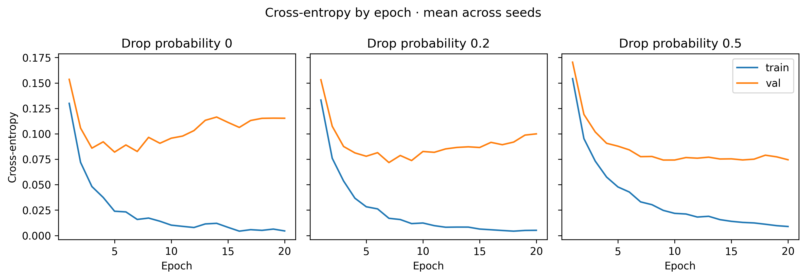

# Does dropout improve digit recognition on MNIST?

A COMP 6130 Data Mining project comparing three PyTorch classifiers trained on the same handwritten digits. The only change within each paired run was the probability of dropping a hidden activation during training.

**Both dropout rates improved average accuracy on unseen digits.** Across three training seeds, a 50% drop rate raised mean test accuracy from 97.87% to 98.09% and narrowed the gap between training and validation accuracy by 0.26 percentage points. The two dropout models finished within 0.04 percentage points of each other on the test set.

| Hidden-unit drop rate | Training accuracy | Validation accuracy | Test accuracy | Train − validation |
|---|---:|---:|---:|---:|
| 0% | 99.47% | 97.80% | 97.87% | 1.67 pp |
| 20% | 99.51% | 98.03% | 98.05% | 1.48 pp |
| 50% | 99.43% | 98.02% | 98.09% | 1.40 pp |

Each row averages three checkpoints, one per seed, selected by minimum validation loss. All nine checkpoints were scored on the same 10,000 test images. [Full results with seed variability](mnist-dropout-project/presentation/experiment_summary.md)



The baseline illustrates why the project tracks loss alongside accuracy. Its training loss approaches zero while its validation loss begins to rise. At epoch 20, mean validation cross-entropy was 0.1153 with dropout disabled and 0.0745 with 50% dropout.

## Try the classroom demo

From this prepared workspace, launch Jupyter with the saved models:

```sh
cd mnist-dropout-project
source .venv/bin/activate
jupyter lab notebooks/live_demo.ipynb
```

Run the notebook once, then rerun **Draw a digit**. All three models see the same test image. Compare the true label, each prediction and the probabilities assigned to competing digits. For a fresh checkout, follow the [installation and dataset instructions](mnist-dropout-project/README.md#install-and-verify).

## Explore the project

| To… | Open |
|---|---|
| Reproduce all 15 training runs | [Experiment guide](mnist-dropout-project/README.md#reproduce-the-experiments) |
| See how training-set size affected accuracy | [Dataset-size results](mnist-dropout-project/presentation/experiment_summary.md#dataset-size) |
| Inspect individual mistakes and per-class metrics | [Experiment notebook](mnist-dropout-project/notebooks/dropout_experiment.ipynb) |
| Trace a minibatch through dropout and backpropagation | [Network](mnist-dropout-project/src/model.py) and [training loop](mnist-dropout-project/src/train.py) |
| Present the study in 18 minutes | [Slide outline](mnist-dropout-project/presentation/presentation_outline.md) and [speaker notes](mnist-dropout-project/presentation/speaker_notes.md) |
